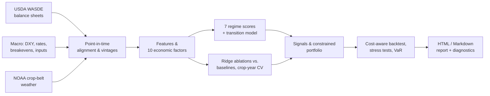
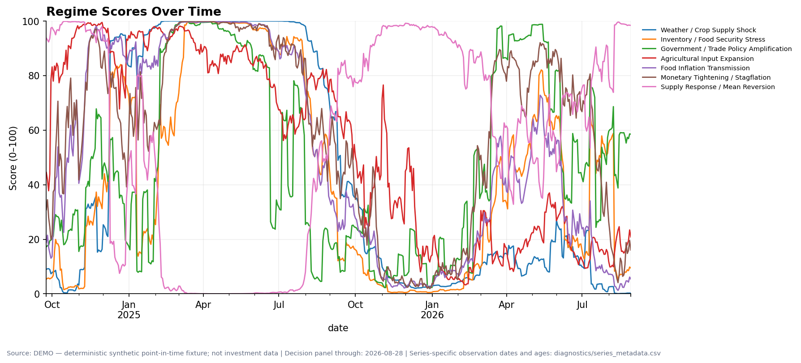
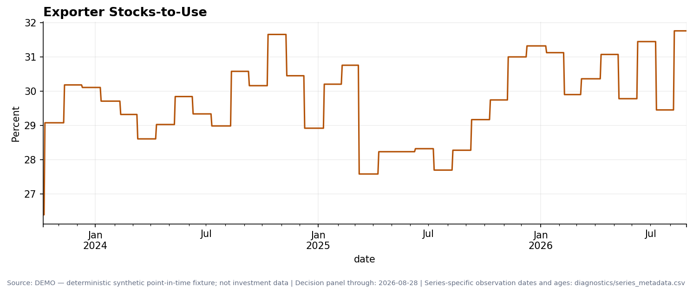

# Agricultural Macro Regime Monitor

Do USDA supply-demand balance sheets, weather, and macro conditions tell us anything about where grain prices go next, once we only use information that was actually public at the time?

  

## Research question

Grain prices are set by balance sheets: production, use, and ending stocks, summarized each month in the USDA World Agricultural Supply and Demand Estimates (WASDE). They are also moved by the dollar, interest rates, input costs (fertilizer, natural gas), weather, and trade policy. This project builds a **point-in-time** monitor that turns those inputs into economic factors and transparent macro regimes. It then asks one falsifiable question: do public WASDE revisions and crop-belt weather add out-of-sample forecasting power for 21-session wheat, corn, and soybean futures returns beyond simple price and seasonal baselines?

## Key findings

From the preregistered experiment `zw_zc_zs_21d_v1`. Development folds cover crop years 2014–2022 (1,147 weekly decisions). The locked holdout covers the last three complete crop years per crop (471 decisions, opened once). Full tables are in [`reports/predictive_experiment_v1/report.md`](reports/predictive_experiment_v1/report.md).

- **Balance-sheet information is crop-specific.** Adding WASDE revisions (production, yield, ending stocks, stocks-to-use) to the price/calendar ridge model raised pooled development OOS R² from −2.83% to −2.06%. For **wheat** it was the only feature family with a positive development OOS R² (+0.68% vs. the historical mean). For corn and soybeans it added noise. Weather alone also helped wheat (−0.47% vs. −1.87% for the core model).
- **One-month grain returns are close to a martingale, and naive trend-following fails.** Every development model sat within about 3–7% of the historical-mean benchmark in MSE. 60-session momentum lost decisively: holdout OOS R² of −281% and a Spearman IC of −0.20.
- **The development-selected model held up on unseen data.** The locked ridge model (price, calendar, and cross-grain features) earned a holdout OOS R² of +1.49% vs. the historical mean, with a Spearman IC of 0.106. By crop: corn +2.8%, wheat +2.0%, soybeans −0.8%. On the raw vendor-stitched series it reached +2.59%, with an IC of 0.176.
- **The signal survives realistic costs.** Translated into a capped weekly long/short portfolio over the common holdout (Jun 2023–Aug 2025, 569 sessions), it earned a net Sharpe of 0.71 at 1× costs and 0.60 at 2× costs. Annualized net return was 4.7% at 6.6% volatility, with a −10.1% maximum drawdown. The preregistered claim gate classifies this as *exploratory support*, pending replication on individual contracts with a new untouched holdout.
- **Look-ahead is controlled by construction.** WASDE values become usable one day after release and trade the next session. Weather enters with a three-day lag. Every scaler, imputer, and ridge penalty is fit on training rows only. Labels that overlap a test boundary are purged, with a five-business-day embargo.

## Approach

The system has two layers that share the same point-in-time data contract.

1. **Regime monitor.** Revision-aware observations (USDA balance sheets, crop condition, DXY, 2-year yields, breakevens, urea, natural gas, policy stress) are aligned to an end-of-day decision cutoff. They feed ten robust-z-scored factors (e.g. exporter stocks-to-use, yield revision, corn/urea affordability), which are combined into seven 0–100 regime scores. The scores decompose exactly into per-factor contributions. A transition model then gives 1-week, 1-month, and 3-month regime probabilities, which drive signals, a constrained portfolio, and a cost-aware backtest.
2. **Predictive experiment.** Real WASDE, NOAA, and futures data feed nested ridge-regression ablations (core, +USDA, +weather, +both) against four fixed baselines. They are evaluated on expanding crop-year folds with purging and embargo, and then once on a locked holdout.



<p align="center">
  <br/>
  <em>Seven regime scores from the offline demo run (synthetic fixture). Each score decomposes exactly into factor contributions.</em>
</p>

<p align="center">
  <br/>
  <em>Exporter stocks-to-use as the monitor sees it: a step function that updates only on publication dates (demo fixture).</em>
</p>

## Repository layout

| Path | Contents |
|---|---|
| `src/agri_macro_quant/ingestion/` | Demo, cache, and live adapters (Yahoo, FRED/ALFRED, CSV); checksum-verified snapshots |
| `src/agri_macro_quant/alignment/` | Point-in-time alignment, vintage replay, staleness masking, look-ahead audits |
| `src/agri_macro_quant/features.py`, `factors.py`, `economics.py` | Causal features, ten factors, fertilizer-margin and affordability ratios |
| `src/agri_macro_quant/regimes.py`, `transitions.py` | Seven decomposable regime scores; multi-horizon transition forecasts |
| `src/agri_macro_quant/signals.py`, `portfolio.py`, `risk.py`, `backtest.py` | Signals, constrained sizing, VaR/CVaR and stress tests, cost-aware backtest |
| `src/agri_macro_quant/research/` | WASDE/NOAA acquisition, predictive experiment, lead-lag/Granger, event study |
| `config/` | Factor and regime weights, assets, data sources, frozen experiment spec |
| `tests/` | 137 tests: point-in-time integrity, endpoint invariance, accounting, CV leakage |
| `docs/` | [Methodology](docs/methodology.md), [predictive experiment](docs/predictive_experiment.md), [operations](docs/operations.md) |
| `reports/` | Predictive-experiment results and a sample demo report |
| `scripts/` | `download_data.py` (public data fetch), `run_predictive_experiment.py` |

## Reproducing

Requires Python 3.11+.

```bash
python -m venv .venv && source .venv/bin/activate
pip install -e '.[dev]'
python -m pytest                                        # 137 tests, about 75 s

# 1) Regime monitor on the deterministic synthetic fixture (offline, no keys)
agri-macro run --mode demo --start 2023-01-01 --as-of 2025-12-31

# 2) Predictive experiment on public data (USDA WASDE, NOAA, futures proxies)
python scripts/download_data.py
agri-macro predictive-experiment --output-dir reports/my_rerun
```

The repository ships no raw data. `scripts/download_data.py` fetches the USDA WAOB historical WASDE CSVs (about 180 MB), NOAA NCEI daily summaries, and continuous futures proxies, then writes a hashed data-lineage table. Live mode needs `FRED_API_KEY` for FRED/ALFRED series (see `.env.example`). Series without a wired-in public feed (urea, crop condition, policy events) plug in through the configurable CSV feed in `config/data_sources.yaml`.

## Paper / report

- Predictive experiment report: [`reports/predictive_experiment_v1/report.md`](reports/predictive_experiment_v1/report.md). The preregistered specification is in [`preregistered_config.yaml`](reports/predictive_experiment_v1/preregistered_config.yaml), and per-asset and per-crop-year metrics are under `primary/` and `raw_sensitivity/`.
- Example monitor output (synthetic demo): [`reports/demo_example/report.md`](reports/demo_example/report.md)
- Model equations and assumptions: [`docs/methodology.md`](docs/methodology.md)

## Author

Siyan Chen · University of California, Santa Barbara · siyan_chen@ucsb.edu
